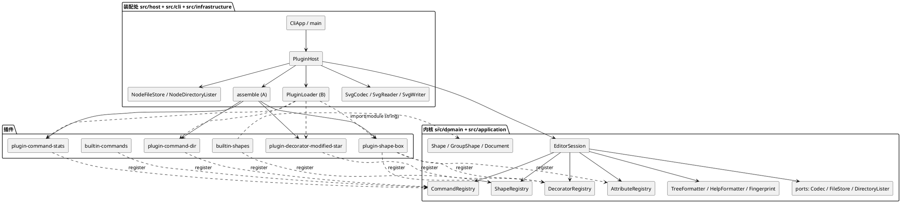

# Lab1 Phase 2 文档：插件实践与插件式重构

本文件是 Phase 2 的交付文档：第一部分（VSCode 扩展）的说明与复用分析见 [`doc/vscode-extension.md`](vscode-extension.md)，本文覆盖第二部分的框架设计、扩展点清单、两种装配方式、ADR、指标与过程记录，并保留 Phase 1 的架构结论作为对照。

- 代码仓库：`git@github.com:Truhide/SVG-CLI.git`，Phase 1 收尾提交打 `final`，Phase 2 收尾提交打 `p2`。
- 语言与运行环境：TypeScript 5.9（strict）、Node.js 24，测试用 Node 内置 test runner（经 `tsx` 运行 TS）。
- 命令与错误文案的契约由 `phase_cli_1.md` 与 `phase_cli_2.md` 给出，Phase 2 不修改 Phase 1 的行为。

---

## 0. 一页速览

| 问题 | 结论 |
|---|---|
| 内核依赖了哪些具体实现？ | 零个。内核只依赖 `ShapeProvider` / `CommandSpec` / `TreeDecorator` / `AttributeHandler` 四个接口与三个注册表。 |
| `box` 改了内核吗？ | 没有。`box` 由 `plugins/plugin-shape-box` 提供图形、属性语义与 `(box)` 标签，内核 0 行改动（见 §4.6 的 diff 判据）。 |
| `stats`/`dir` 改了内置命令表吗？ | 没有。它们各自是独立包，通过 `ctx.commands.register` 进入同一注册表，`help` 自动列出。 |
| 两种装配方式怎么保证等价？ | 同一个 `createHost`，同一个 `PluginContext`，同一条注册路径；差别只在"谁来实例化插件"。（§3） |
| 没有插件框架时还能用吗？ | 能。宿主先激活内置包，`--config` 只追加可选插件；`plugins.base.json`（空列表）的输出与 `final` 逐字节一致（`tests/cli-assembly.test.ts`）。 |
| 指标从哪来？ | `node scripts/metrics.mjs final p2` 从 git 历史生成 `docs/metrics/`，不接受手填。 |

---

## 1. 四个扩展点

### 1.1 扩展点清单

"内核调用位置"一列给到文件与函数；"缺省行为"指禁用本阶段可选插件（仅保留内置包）时的行为；"违反契约"指实现方不满足接口约定时框架的报错路径。

| 扩展点 | 接口（内核侧） | 职责 | 内核调用位置 | 本阶段的实现 | 缺省行为 | 违反契约时 |
|---|---|---|---|---|---|---|
| `ShapeProvider` | `src/application/extension/ShapeProvider.ts` 的 `ShapeProvider` / `BaseShapeProvider` | 一种图形类型的 `create` 语法、读回、几何属性与文本体 | `ShapeRegistry.create`（`src/application/extension/ShapeRegistry.ts`）←`CreateCommand.execute`；`ShapeRegistry.providerForElement` ←`SvgReader.importElement`（`src/infrastructure/svg/SvgReader.ts`）；`SvgNodeEmitter.emit`（`src/infrastructure/svg/SvgNodeEmitter.ts`）取 `attributes`/`body`；`HelpFormatter.format`（`src/application/format/HelpFormatter.ts`）打印 `helpUsage` | 内置：`src/plugins/builtin-shapes/{Rect,Circle,Ellipse,Line,Text,Group}Provider.ts`；可选：`plugins/plugin-shape-box/BoxProvider.ts` | `create box …` → `error: unknown shape type: box (is the plugin loaded?)`；读入未知元素 → `warning: unsupported element <x> skipped`；六种图形与 `help` 文本保持 Phase 1 | 同名重复注册 → `error: duplicate registration: shapes/<name>`；`importFrom` 抛错 → 整个读入失败，原文档不变；`verify` 抛错 → 同上（例：`invalid box n1: …`） |
| `Command` | `src/application/extension/CommandSpec.ts` 的 `CommandSpec`（+ `src/application/Command.ts` 的 `Command` 抽象类） | 一条命令的名字、help 段落与工厂 | `CommandRegistry.create` ←`EditorSession.execute`；`HelpFormatter.format` 遍历 `CommandRegistry.entries()`；`EditorSession.commandNames` | 内置：`src/plugins/builtin-commands/index.ts`（19 条）；可选：`plugins/plugin-command-stats/index.ts`、`plugins/plugin-command-dir/index.ts` | `stats`/`dir` → `error: unknown command: stats`；`help` 只列已注册命令 | 重名 → `error: duplicate registration: commands/<name>`；需要文档却无文档 → `error: no document. use 'init' or 'read' first`；工厂抛错 → `error: <message>` |
| `TreeDecorator` | `src/application/extension/TreeDecorator.ts` | 结构树行尾标签，纯查询 | `TreeFormatter.decorate`（`src/application/format/TreeFormatter.ts`），由 `formatDocument`/`formatShape`/`render` 调用；标签集合来自 `TreeCommand.execute` 的 `session.decorators.list()` | `plugins/plugin-shape-box/BoxLabelDecorator.ts`（`(box)`）、`plugins/plugin-decorator-modified-star/ModifiedStarDecorator.ts`（`*`） | 装饰器集合为空 → `tree` 输出与 Phase 1 逐字节一致（`tests/cli-assembly.test.ts`、`tests/tree-decorator.test.ts`） | 重名 → `error: duplicate registration: decorators/<name>`；`decorate` 抛错 → `tree` 输出 `error: <message>`，文档不受影响 |
| `AttributeHandler` | `src/application/extension/AttributeHandler.ts` | 某属性在某图形上的领域语义 | `SetCommand.execute/undo/redo`（`src/plugins/builtin-commands/SetCommand.ts`）：`matching`→`createEdit`→`apply`/`revert`，`read` 供 undo 反馈 | `plugins/plugin-shape-box/BoxAttributeHandler.ts`（`fill`/`label`） | `set n1 label …` → `error: unknown attribute: label`；`fill` 回到 Phase 1 白名单规则 | 重名 → `error: duplicate registration: attributes/<name>`；多个处理器同时命中 → `error: ambiguous attribute handler: fill (box-attributes, second-fill)`；`apply` 抛错 → 已应用的编辑被 `revert`，文档与 undo/redo 历史保持原状 |

**注册表与内核的关系**：`ShapeRegistry`、`CommandRegistry`、`TreeDecoratorRegistry`、`AttributeHandlerRegistry`（均在 `src/application/extension/`）只提供 `register/remove/查询`，自身不 import 任何实现；`register` 会通知订阅者（`onRegister`），这是加载器做"暂存-校验-回滚"的唯一钩子。

### 1.2 内核不按名字枚举

Phase 1 的两处 `switch`/`Map` 分派（`ShapeFactory`、`CommandRegistry` 的构造函数）已消失：

- `ShapeRegistry.create(name, …)` 只按注册名查表，`providerForElement` 反序询问 `accepts`（后注册者优先，`box` 借此接管 `<g data-kind="box">`）。
- `CommandRegistry` 出厂为空，19 条内置命令由 `src/plugins/builtin-commands` 注册。
- `help` 文本由 `HelpFormatter` 从注册表拼装：命令自带 `help.group` 与 `help.lines(ctx)`，`create` 的用法行来自各 `ShapeProvider.helpUsage`。

因此"新增一种图形/一条命令"不会触碰内核任何分支；禁用可选插件时注册表内容与 Phase 1 相同，输出逐字节一致。

---

## 2. 模块结构与依赖

### 2.1 Phase 1（重构前）

```text
src/domain/         Shape / Rect·Circle·Ellipse·Line·Text / GroupShape / Document / StyleAttributes …
src/application/    Command、19 条命令、CommandRegistry（构造时注册）、ShapeFactory（构造时注册）、TreeFormatter …
src/infrastructure/ SvgReader / SvgNodeEmitter（访问者）/ SvgWriter / XmlParser / NodeFileStore
src/cli/            CliApp / main.ts（组合根）
```

问题：图形类与命令表硬编码在应用层；`SvgNodeEmitter` 通过 `ShapeVisitor` 依赖每个具体图形类；新增 `box` 必须改内核与渲染器。

### 2.2 Phase 2（重构后）

```text
src/domain/                内核模型：Shape（抽象）、GroupShape、RootShape、Document、StyleAttributes、Numbers、Transform2D
src/application/
  extension/               扩展点接口与注册表（ShapeProvider/CommandSpec/TreeDecorator/AttributeHandler/PluginContext）
  format/                  TreeFormatter（含装饰器挂点）、Fingerprint、ShowFormatter、HelpFormatter、CountLabel
  ports/                   DocumentCodec、FileStore、DirectoryLister、DecodedDocument
  Command.ts / EditorSession.ts / CommandHistory.ts / CommandLine.ts / Token.ts / CommandResult.ts
src/infrastructure/        适配器：SvgReader/SvgWriter/SvgNodeEmitter/SvgCodec/XmlParser/NodeFileStore/NodeDirectoryLister
src/host/                  装配处：PluginHost（两条装配路径的公共入口）、assemble（方式 A）、PluginLoader（方式 B）、
                           PluginManifest、PluginContextFactory
src/plugins/builtin-shapes/    既有六个 ShapeProvider + 五个叶子图形类（Phase 1 的 domain 叶子迁到这里）
src/plugins/builtin-commands/  既有 19 条命令 + 命令表插件
src/cli/                   REPL：CliApp / ConsoleOutput / main（参数解析、组装 session）
plugins/                   可选插件包（独立目录、各自 package.json + contributes）
```

**依赖图（PlantUML 源文件：[`doc/architecture-p2.puml`](architecture-p2.puml)）**



**依赖规则（Phase 2 仍然满足）**

| 规则 | 说明 |
|---|---|
| `domain` 不依赖其他层，也不 import `node:*` | 五个叶子图形类已迁到 `src/plugins/builtin-shapes`，`Shape` 只保留与类型无关的模板方法；`GroupShape` 提供 `beforeRemoveChild`/`canUngroup` 两个可覆写钩子 |
| `application` 只依赖 `domain` | 扩展点接口不 import 任何实现；`TreeFormatter` 通过 `TreeDecorator` 接口追加标签 |
| `infrastructure` 依赖 `application` 的端口与注册表 | `SvgNodeEmitter` 只经 `ShapeRegistry` 取 `attributes`/`body`，不再 `import` 具体图形类 |
| `src/plugins/builtin-*` 只依赖内核公开抽象 | 内置命令用 `session.shapes/commands/decorators/attributes`，不 import `src/host` |
| `plugins/*` 只依赖内核公开抽象 | `box` 通过 `ctx.shapes` 创建 `rect`/`text` 子部件，不 import 内置图形包；`dir` 只用 `DirectoryLister` 端口 |
| 只有 `src/host`、`src/cli` 装配 | `main.ts` 负责 `--config` 解析与 session 组装；`PluginLoader` 不含任何具体插件 import |

检查方式（人工可复现）：在内核目录搜索 `from '../../plugins` 与 `from '../../src/plugins` 应为 0 处；在 `src/host/PluginLoader.ts`/`PluginManifest.ts` 搜索 `plugin-shape-box|plugin-command|plugin-decorator|switch` 应为 0 处（加载器只认字符串）。

---

## 3. 两种装配方式

两条路径都从 `src/host/PluginHost.ts#createHost` 进入：

```ts
const context = new HostContext(services);
builtinShapes.activate(context);     // 内置能力，任何模式都在
builtinCommands.activate(context);
if (configPath === null) {
  registerOptionalPlugins(context);  // 方式 A：src/host/assemble.ts
} else {
  await new PluginLoader(context, report).loadFromFile(configPath); // 方式 B
}
```

### 3.1 方式 A：改代码

`src/host/assemble.ts` 是唯一的组合根：

```ts
export function registerOptionalPlugins(context: PluginContext): void {
  boxShape.activate(context);
  statsCommand.activate(context);
  dirCommand.activate(context);
  modifiedStar.activate(context);
}
```

新增一个插件 = 一处 import + 一次 `activate`，类型检查完整、调试直接；代价是必须改这一行并重新构建。

### 3.2 方式 B：改配置

仓库根 `plugins.config.json`：

```json
{
  "plugins": [
    { "module": "./plugins/plugin-shape-box" },
    { "module": "./plugins/plugin-command-stats" },
    { "module": "./plugins/plugin-command-dir" },
    { "module": "./plugins/plugin-decorator-modified-star" }
  ]
}
```

- `module`：相对路径以**配置文件所在目录**为基准；绝对路径直接使用；裸包名交给 Node 的模块解析（`createRequire(...).resolve`），因此装上 `@svgframe/plugin-*` 包后无需改加载器。
- `options`：以 `ctx.options` 原样交给该插件（`ConfiguredContext` 为每个条目包一层视图），不会与其他插件共享。
- `enabled: false`：完全跳过，不 import、不校验。
- 加载顺序即数组顺序；同一类别重名会被拒绝。

插件用自己 `package.json` 的 `contributes` 声明贡献，加载器在激活后比对：

```json
{
  "name": "@svgframe/plugin-shape-box",
  "main": "index.ts",
  "contributes": { "shapes": ["box"], "attributes": ["box-attributes"], "decorators": ["box-type-label"] }
}
```

### 3.3 加载契约与失败处理

| 情形 | 输出（`error:` 开头，随后继续启动） |
|---|---|
| 模块找不到 | `error: plugin not found: <module>` |
| 没有默认导出 | `error: plugin has no default export: <module>` |
| `contributes` 与实际注册不一致 | `error: plugin manifest mismatch: <name> (commands: declared=[foo] registered=[bar])` |
| `activate` 抛错 | `error: plugin failed to activate: <name> (<reason>)` |
| 同类注册名重复 | `error: duplicate registration: <category>/<name>` |
| 配置语法/结构不合法 | `error: invalid plugin config`（以默认内置能力启动） |

实现要点（`src/host/PluginLoader.ts`）：

1. **先解析、后求值**：相对/绝对路径先 `existsSync` + 目录解析（`package.json#main` 或 `index.ts`），裸包名用 `createRequire` 解析。解析失败才是 `plugin not found`；模块存在但求值（含其依赖）失败属于加载失败，报 `failed to activate`，不会误报"找不到"。
2. **记录-回滚**：四个注册表的 `onRegister` 在 `activate` 期间把 `(category, name)` 记进 `recorded`，失败时逆序 `remove`。因此"清单不一致""激活抛错""重复注册"都只撤销该插件自己的注册，已成功的插件保留。
3. **清单比对**：声明缺省为空数组，类别固定为 `shapes/commands/decorators/attributes`，比较排序后的名字集合；不一致即拒绝。
4. **不硬编码**：加载器里没有具体插件的 import、名字映射或条件分支（只有四个注册表与字符串处理）。

### 3.4 双装配一致性与兼容性

```bash
# 方式 A（默认入口）
<启动入口> < doc/transcript/cli-2-box.txt
# 方式 B
<启动入口> --config plugins.config.json < doc/transcript/cli-2-box.txt
# 两次输出 diff 必须为空
```

`tests/cli-assembly.test.ts` 用 `child_process` 在**同一个内容固定的临时工作目录**里跑三份 transcript（`cli-1-base`、`cli-2-box`、`cli-3-plugins`），逐字节比较两种装配；日志只写 stdout，不写入该目录，避免 `dir` 的输出被日志文件污染。

基础兼容性用空配置（`plugins.base.json`）对照 `final` 的真实输出：

```bash
<启动入口> --config plugins.base.json < doc/transcript/cli-1-base.txt
# 与 doc/transcript/expected/cli-1-base.final.txt 逐字节一致
```

### 3.5 装配演示提交

| 演示 | 提交内容 | 判据 |
|---|---|---|
| A | `demo/assembly-a` 分支：新增 `plugins/plugin-decorator-modified-star/**`，**只**修改 `src/host/assemble.ts` | `git diff --name-status C^ C` 只有新插件目录 + 一个顶层装配文件 |
| B | `demo/assembly-b` 分支：新增同一插件包，**只**修改 `plugins.config.json` | 运行代码 0 改动，diff 只有新插件 + 配置 |
| 共同 | 两条分支都以不含该插件的提交为基点 | 排除新插件目录后，内核与既有插件 diff 为空 |

---

## 4. 关键设计

### 4.1 `box`：图形 + 属性语义 + 标签，一个包三处贡献

`plugins/plugin-shape-box` 同时注册 `BoxProvider`（`shapes: ["box"]`）、`BoxAttributeHandler`（`attributes: ["box-attributes"]`）、`BoxLabelDecorator`（`decorators: ["box-type-label"]`）。

- `BoxShape extends GroupShape`：`kind = 'box'`、`typeName = 'g'`（因此 `label()` 是 `g#n1`，SVG 也是 `<g>`），`canUngroup = false`，`beforeRemoveChild` 拒绝移走必要子部件。
- 子部件 id 固定为 `<id>-rect` 与 `<id>-label`；创建时通过 `ctx` 提供的 `ShapeRegistry` 复用 `rect`/`text` 两个 provider，因此**不依赖内置图形包**。
- 序列化为 `<g id="n1" data-kind="box">`；读回时 `accepts('g', source)` 要求 `data-kind="box"`，`providerForElement` 反序询问使它在内置 `g` 之前被选中；未装插件时同一文件按普通 `<g>` 读入（降级）。
- 冲突与不变量：`Document.attach` 会检查**整棵**新子树的 id（`assertSubtreeIdsFree`），所以 `n1-rect` 已存在时整条 `create` 失败且不留半个容器；`verify` 在读入后校验两个部件齐全。

### 4.2 属性处理器：一次 `set` 一个事务

```ts
export interface AttributeHandler {
  readonly name: string;
  handles(shape: Shape, attr: string): boolean;
  read(shape: Shape, attr: string): string | null;          // undo 反馈用
  createEdit(shape: Shape, attr: string, value: string): AttributeEdit; // 只构造，不修改
}
export interface AttributeEdit { apply(): void; revert(): void; }
```

`SetCommand` 的流程：定位图形 → 查询处理器 → 0 个走 Phase 1 白名单；1 个则 `createEdit` 后 `apply`；>1 个直接报错（不做未定义覆盖）。处理器在 `apply` 中途抛错时，命令先 `revert` 再重抛，`EditorSession` 打印 `error: …`，且因为 `execute` 未返回，命令不会进入 undo 历史。`undo`/`redo` 直接调用同一个 `revert`/`apply`，所以"改多个子部件也只算一次撤销"。

### 4.3 树标签：内容指纹

`Fingerprint.of(shape)` 递归生成 `label|summary|[children…]` 字符串（包含几何、样式与文本内容），`TreeRow` 把它交给装饰器。`modified-star` 在 `EditorEvents.onSaved` 时把每个 id 的指纹存进**实例字段**，渲染时比较：不相等就返回 `*`。两个装饰器互不感知，渲染器按注册顺序用空格拼接。

### 4.4 `dir`：适配器模式

- 目标接口：`src/application/ports/DirectoryLister.ts`（`list(path): DirectoryEntry[]`，`DirectoryEntry` 区分 `dir/file/link`，链接只报告目标文本）。
- 适配器：`src/infrastructure/fs/NodeDirectoryLister.ts`（`readdirSync` + `lstatSync`；失败翻译为 `cannot read directory: <path>`）。
- 客户端：`plugins/plugin-command-dir/DirCommand.ts` 只依赖端口，负责排序（目录在前、其次链接与文件）、格式（`[DIR]  name` / `[FILE]  name` / `[LINK]  name -> target`）、空目录 `(empty directory)`。
- 角色对应：`DirectoryLister` = Target，`NodeDirectoryLister` = Adapter，`DirCommand` = Client，`PluginServices` = 把适配器注入插件的装配点；测试替身 `FakeDirectoryLister`（`tests/support/TestEditor.ts`）替换适配器即可单测命令逻辑，真实适配器另有临时目录的集成测试。
- 命令语义：不读文档、不改 dirty、不动 undo/redo、不改变工作目录；`dir` 与 `tree` 一样只是查询。

### 4.5 事件与"已保存水位"

内核只发布一个事件：`EditorEvents.emitSaved(document)`。`EditorSession.replaceDocument`（`init`/`read`）与 `SaveCommand` 的 `session.markSaved()` 都会触发它。装饰器在 `activate` 时订阅，把水位放进自己的字段——这样 `undo` 回到保存点后 `*` 自然消失，而 `init`/`read` 后的新文档从"干净"开始。

### 4.6 判据命令与实测结果

```bash
# 内核与既有插件在"接入 box"的提交里 0 改动（排除新插件目录）
git diff C^ C -- src/domain src/application src/plugins/builtin-shapes src/plugins/builtin-commands ':(exclude)plugins/plugin-shape-box'
# → 空输出（且路径确实存在，不是 git 忽略错误路径） 

# 加载器不含具体插件 import / 名字映射 / 分支
rg -n "plugin-shape-box|plugin-command|plugin-decorator|switch \(" src/host/PluginLoader.ts src/host/PluginManifest.ts
# → 无匹配
```

> 注意：`git diff` 对不存在的路径会返回空结果，因此在文档与脚本中都先确认路径存在（`Test-Path`/`ls`）再比对；本阶段的实际比对记录见 §7 过程记录。

---

## 5. ADR

### ADR-1 属性扩展点的调用与事务契约

**决定**：处理器接口拆成 `handles`（纯判断）、`read`（当前值）、`createEdit`（构造可逆编辑）；内核负责 `apply`/`revert` 的时机与失败回滚；多个处理器命中同一 `(图形, 属性)` 时**拒绝执行**（`ambiguous attribute handler`）。

**理由**：处理器若能直接 `apply`，内核无法在"部分修改后抛错"时回滚，也无法保证一次 `set` 只占一个 undo 单元。把"修改"表达成 `AttributeEdit` 让事务边界留在内核，同时处理器仍可用图形公开方法（`setAttribute`/`removeAttribute`）修改子部件，字段保持封装。冲突策略选"拒绝"而不是"按优先级取一个"：优先级只会把两个插件的语义分歧藏起来，报错让冲突在接入时就暴露。

**后果**：`set` 中处理器路径比默认路径多一次 `createEdit` 分配；处理器作者必须保证 `apply`/`revert` 对称。测试：`tests/attribute-handler.test.ts`（单属性、双子部件一个 undo 单元、歧义、回滚）。

### ADR-2 `box` 的读回策略与不变量

**决定**：
1. 装了插件但 `<g data-kind="box">` 缺少 `<rect id="*-rect">` 或 `<text id="*-label">`、或子项多于两个时，**拒绝整个读入**（`error: invalid box …`），保持原文档。
2. 未装插件时，同一文件按普通 `<g>` 读入（`data-kind` 被忽略），即"降级为分组"。
3. 对于已存在的 box，删除/移走必要子部件的命令在 `Document.detach` → `GroupShape.beforeRemoveChild` 处被拒绝；`ungroup` 由 `canUngroup=false` 拒绝。
4. 子部件 id 冲突时整条 `create` 失败（`Document.attach` 先检查整棵子树）。

**理由**：一个缺部件的 box 对象在任何 `set fill/label` 上都会失败，把错误推迟到使用点是更差的体验；拒绝读入比"警告 + 半残对象"更容易推理，也满足"重复 id 必须拒绝整份文档"的规格。降级只在"插件不存在"时发生，此时 box 语义本来就不存在，普通分组是最接近的原样保留。

**后果**：读入失败粒度是整份文档（与 Phase 1 的"畸形 XML 整份失败"一致）；`box` 不能通过 `ungroup` 拆开，用户要拆只能 `delete` 整个 box（或先 `addto` 到别的容器——但子部件被拒绝）。测试：`tests/shape-plugin.test.ts`。

### ADR-3 dirty 语义：内容指纹 + 祖先传播 + 固定拼接顺序

**决定**：
- `*` 的语义是**内容与上次保存不一致**（指纹比较），不是"发生过编辑命令"。
- 行指纹覆盖整棵子树，因此子图形变化会让祖先容器行也带 `*`。
- 新节点（保存之后创建）立即带 `*`。
- 多个标签按**装饰器注册顺序**用空格拼接，例如 `g#n1 (box) *`。

**理由**：内容语义与用户的直觉一致（`undo` 回到保存点就不该再显示"未保存"），也避免维护"脏 id 集合"在 `undo` 时的补偿逻辑；祖先传播让"哪里变了"在折叠视图里也可见；顺序取注册顺序而非名字排序，是为了让装配顺序成为唯一的可见差异来源（与 `help` 的段落顺序一致）。

**后果**：每行渲染要计算一次子树指纹（本项目规模可忽略）；`undo` 到"与保存内容相同"的状态会清掉 `*`，即使中间执行过编辑命令。测试：`tests/tree-decorator.test.ts`。

### ADR-4 配置清单的校验时机：激活后比对 + 全量回滚

**决定**：加载器先让插件 `activate`（注册直接落到真实注册表，同时被 `onRegister` 记录），再比对 `contributes`；任何失败都逆序 `remove` 该插件记录到的注册。配置语法/结构错误在读文件阶段就判定。

**理由**：`contributes` 描述的是"实际注册了什么"，只有激活后才知道；若在激活前拦截，就得为每个插件设计静态描述格式，等于把注册表语义复制一份。记录-回滚比"两阶段提交"简单：注册表只提供 `register/remove`，回滚顺序天然是逆序，且失败插件的注册对其他插件不可见（顺序加载、单线程）。

**后果**：插件在 `activate` 期间短暂可见自己的注册（例如 `box` 用自己的 `rect` 子 provider 不受影响）；若插件在 `activate` 里读取其他插件的注册，看到的只是已成功加载的插件（顺序敏感，文档已说明）。重复注册会先抛错再回滚，错误信息即 `duplicate registration: <category>/<name>`。测试：`tests/plugin-loader.test.ts`。

---

## 6. 质量保证

### 6.1 类型与静态检查

- `tsconfig`：`strict`、`noImplicitOverride`、`noUnusedLocals`、`noUnusedParameters`、`noFallthroughCasesInSwitch`、`forceConsistentCasingInFileNames`。
- `npm run typecheck` 覆盖 `src/`、`tests/`、`plugins/`（`tests/fixtures/**` 是故意不合法/无默认导出的插件样本，已排除）。
- `npm run build` 通过（`tsc` 输出到 `dist/`）。

### 6.2 测试（`npm test`）

| 文件 | 覆盖点 |
|---|---|
| `tests/session.test.ts` 等 7 个 Phase 1 文件 | Phase 1 全部 46 个用例在重构后仍通过（命令、历史、错误、IO、REPL 分词） |
| `tests/shape-plugin.test.ts` | 未装插件时 `box` 未知；装上后创建/嵌套/整体移动；`ungroup` 与删除子部件被拒；id 冲突整体失败；`data-kind` 序列化与读回；未装插件时降级为 `<g>`；缺部件拒绝读入且原文档保留 |
| `tests/attribute-handler.test.ts` | `fill`/`label` 各自一次 undo/redo；处理器触碰两个子部件仍是一个 undo 单元；无处理器时的白名单回退；歧义处理器报错；处理器中途抛错后文档与历史不变 |
| `tests/tree-decorator.test.ts` | 无装饰器时逐字节保持 Phase 1；`*` 状态机（编辑→保存→再编辑→undo 回保存点）；祖先传播；新建节点立即标记；两个标签并存与拼接顺序；水位封装在实例字段 |
| `tests/command-plugins.test.ts` | `stats` 未加载时未知命令、计数与容器数、空文档、不入 undo；`dir` 排序/隐藏项/空目录/读取失败/无需文档/不影响历史；真实 `NodeDirectoryLister` 与临时目录 |
| `tests/plugin-loader.test.ts` | 四条失败路径、重复注册、部分回滚、配置非法、`enabled:false`、`options` 传递、相对路径基准、失败后继续加载 |
| `tests/cli-assembly.test.ts` | 两种装配对三份 transcript 逐字节一致；空配置对照 `final` 基线；插件会话的关键输出 |

### 6.3 端到端与手工验证

- `doc/transcript/cli-1-base.txt`：Phase 1 §6 会话（含 `help`、`tree`、保存与 undo 锁定）。
- `doc/transcript/cli-2-box.txt`：Phase 1 §6.1 版本 B，用 `box` 重建流程图，含 `set fill/label`、`undo/redo`、保存与读回、`stats`。
- `doc/transcript/cli-3-plugins.txt`：`stats`、`dir`、`box` 属性、两类错误拒绝。
- 预期输出单独保存：`doc/transcript/expected/cli-1-base.final.txt`（由 `final` 代码真实运行生成，UTF-8 无 BOM）。

### 6.4 指标

- 生成：`node scripts/metrics.mjs final p2`（脚本随仓库提交）。
- 产出：`docs/metrics/{README,files,layers,vscode}.md`。
- VSCode 扩展单独统计，不混入 CLI 增量；依赖包与构建产物排除。

---

## 7. 过程记录（含 AI 建议的检查与修正）

### 7.1 先画接口再搬文件

拿到 Phase 2 规格后，第一步不是改代码，而是把四个扩展点写成"清单 + 调用位置"（本文 §1.1 的表格初稿），再按清单搬文件。这一步避免了两类返工：一是把 `ShapeVisitor` 留下来（那样渲染器仍依赖具体图形类），二是让 `box` 去 import 内置 `rect` 实现（那样插件之间产生依赖）。最终 `box` 只经 `ShapeRegistry` 创建子部件。

### 7.2 访问者必须消失

初版重构保留了 `SvgNodeEmitter implements ShapeVisitor`。写"内核 0 改动"的判据时发现：`box` 的图形类在插件包里，渲染器却要 `import` 它才能实现访问者方法——这等于把渲染器绑到插件上。**纠正**：删掉 `ShapeVisitor` 与所有 `accept`，改为 `provider.attributes(shape)` / `provider.body(shape)` 由注册表调用，渲染器只认 `kind`。这一步也让 `treeSummary`/`detailLines` 的模板方法留在内核成为唯一"按类型分派"的替代。

### 7.3 三个"看起来能省"的钩子被否掉

- **让 `GroupShape` 记住自己是不是 box**：会让内核出现 `box` 名字。改为 `kind` 与 `canUngroup`/`beforeRemoveChild` 两个通用可覆写点。
- **在 `Document.attach` 只检查根 id**：`box` 会留下半个容器。改为检查整棵子树（Phase 1 的所有用例仍通过，因为它们的子树只有自己）。
- **让 `dir` 直接 `import 'node:fs'`**：命令会绑死 Node，测试只能用真实目录。改为端口 + 适配器，测试用 `FakeDirectoryLister`。

### 7.4 加载器的"取消订阅"写法返工

第一版 `PluginLoader` 用 `registry.listeners` 的内部字段做反注册，属于依赖内核私有实现。写"加载器独立性"自查时改为 `onRegister` 返回退订函数，四个注册表统一签名。改动很小，但它把"加载器只能通过公开 API 观察注册"变成结构约束，而不是口头约定。

### 7.5 基线文件差点变成 UTF-16

采集 `final` 基线时用 PowerShell 重定向生成了 UTF-16 文件，测试里按 UTF-8 读取时整份内容带 NUL，看起来像"重构改变了输出"。用 `git worktree` 在 `build/` 下检出 `final`，以 `cmd` 重定向重新生成 UTF-8 基线后，p2（空配置）的输出与基线逐字节一致。教训：**基线文件的编码也是契约的一部分**，脚本里必须显式固定。

### 7.6 双装配比较必须固定工作目录

`dir` 依赖进程工作目录，第一版比较脚本直接在仓库根跑，两次运行之间 `build/` 产物变化会污染结果。改为在临时目录 `mkdtemp` 中放固定内容（`build/`、`keep/`、`notes.txt`），日志只写 stdout；这也是规格"验证 dir 时使用内容固定的临时工作目录、输出日志写入该目录之外"的落地方式。

---

## 8. 第一部分：VSCode 插件（摘要）

完整说明见 [`doc/vscode-extension.md`](vscode-extension.md)，这里只列交付要点：

- 扩展目录 `vscode-extension/`：`FileDecorationProvider`（`.svg` 显示 `[]`，不改文件名与内容，目录与非 SVG 无标记）、`DocumentSymbolProvider`（原生 Outline 展示嵌套层级，`标签#id` 命名，点击定位，编辑后更新，不完整 XML 不崩溃）。
- 截图：`docs/images/vscode-svg-badge.jpg`、`docs/images/vscode-svg-outline.jpg`。
- 分析：VSCode 与插件的职责与注册/回调过程；文件装饰与 GoF Decorator 的差异（查询式外部提供者 + 宿主合并渲染 + `FileDecoration` 值对象，没有 `super.decorate()` 链）；与 Adapter 的对应（`URI → FileDecoration`、`XML 树 → DocumentSymbol`）；Phase 1 代码复用评估（XML 词法/实体解码思路与 `标签#id` 命名可复用；`domain.Shape`、严格一次性解析的 `XmlParser`、带 id 索引的 `Document` 不可直接复用，扩展运行在独立 extension host 进程）。

---

## 9. 已知边界

- `box` 的 `fill` 只落到内部矩形；给 `g` 本身设置 `stroke` 仍走 Phase 1 的样式规则（不影响内部子部件），这是"不扩张白名单"的取舍。
- `box` 不支持 `ungroup`；要拆开只能删除整个 box 后重建。
- 读入 `box` 要求两个部件齐全，否则整份文档拒绝；宁可失败也不产生半残对象。
- 装饰器只影响 `tree`，不影响 `show`、保存内容或 SVG 序列化。
- `stats` 把 `box` 内的 `rect`/`text` 当作叶子计数（符合"box 内部叶子照常计数"），容器数包含 `box`。
- `dir` 只列直接子项，不递归；符号链接显示为 `[LINK]  name -> target`，不跟随目标。
- 指标中的复杂度是文件级近似（见 `docs/metrics/README.md`），不是逐函数圈复杂度。
