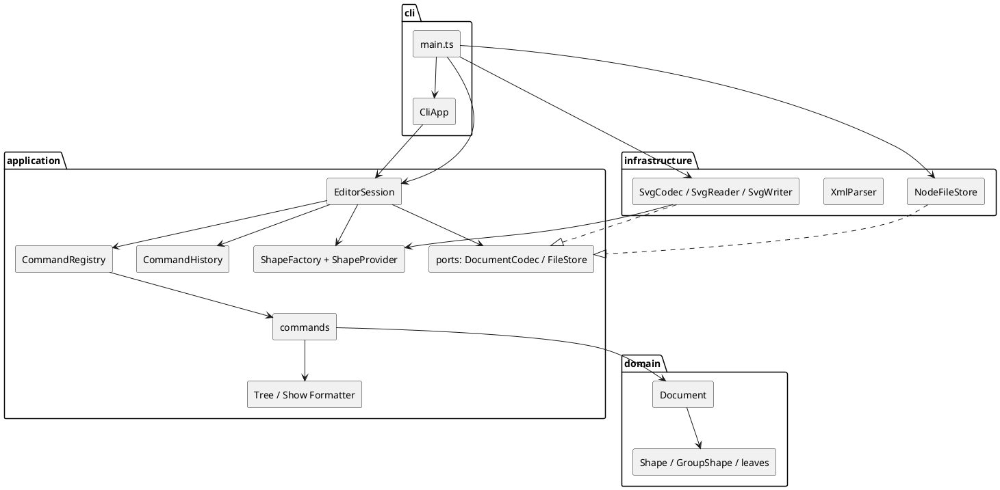

# Lab1 Phase 1 文档：SVG 编辑器（CLI）

实现语言 TypeScript，运行于 Node.js。命令表、错误表、显示格式以 `phase_cli_1.md` 为契约；本文说明架构决策、模式落地、依赖规则与变化点，并记录开发过程中的发现与纠正。

---

## 一、架构方案

### 1. 模块划分

```text
src/
├── domain/                  纯模型，不依赖 IO / 终端 / Node API
│   ├── Shape.ts             抽象基类：id、父指针、样式、move/scale/set 模板方法
│   ├── RectShape.ts …       五个叶子：Rect / Circle / Ellipse / Line / Text
│   ├── GroupShape.ts        Composite 容器：move/scale 递归到子节点
│   ├── RootShape.ts         文档根（<svg>），容器语义，但不可被 id 寻址
│   ├── Document.ts          画布尺寸 + 形状树 + id 索引 + attach/detach
│   ├── StyleAttributes.ts   fill / stroke / stroke-width 值对象（含校验）
│   ├── Transform2D.ts       读入 SVG 时折叠 translate/scale 的仿射值对象
│   ├── ShapeVisitor.ts      访问者接口（序列化等按具体类型分派）
│   ├── Numbers.ts           数字解析与无指数格式化
│   └── errors/EditorError.ts 用户可见错误（统一由 CLI 加 `error: ` 前缀）
│
├── application/             用例层：只依赖 domain
│   ├── Command.ts           Command 模式根：requiresDocument / undoable / execute / undo / redo
│   ├── commands/            19 个命令，一类一文件
│   │   ├── SessionCommand.ts / EditSessionCommand.ts   参数解析与“可撤销”基类
│   │   ├── Init/Read/Save/CanvasCommand               文档类（不进入 undo 栈）
│   │   ├── Create/Delete/Move/Scale/Set/Group/Ungroup/AddTo/Front/BackCommand
│   │   └── Tree/Show/Help/Undo/RedoCommand
│   ├── CommandHistory.ts    undo / redo 栈与“IO 后锁定”策略
│   ├── EditorSession.ts     用例门面：解析一行 → 建命令 → 执行 → 返回输出行
│   ├── CommandLine.ts / Token.ts   行 token 化（引号、转义、`in` 关键字识别）
│   ├── CommandRegistry.ts   命令名 → 命令工厂（按名字分派点 1，标注待重构）
│   ├── CommandResult.ts     输出行 + 对历史的影响（reset / lock / none）
│   ├── HelpText.ts          help 文本
│   ├── format/              TreeFormatter、ShowFormatter（tree/show 的文本表示）
│   ├── ports/               DocumentCodec、FileStore、DecodedDocument（依赖倒置）
│   └── shapes/              ShapeFactory + ShapeProvider + 六个 Provider（按名字分派点 2，标注待重构）
│
├── infrastructure/          适配器：依赖 domain 与 application 的端口
│   ├── xml/                 最小 XML 解析器（声明/注释/CDATA/实体/命名空间前缀）
│   ├── svg/                 SvgCodec、SvgReader、SvgWriter、SvgNodeEmitter、
│   │                        SvgTransformParser、XmlShapeSource、IdAllocator
│   └── fs/NodeFileStore.ts  文件系统实现
│
└── cli/                     REPL / 输出 / 组合根
    ├── CliApp.ts            readline 循环，唯一负责打印
    ├── ConsoleOutput.ts     stdout 输出
    ├── TextOutput.ts        输出端口（便于测试）
    └── main.ts              组合根：装配 ShapeFactory / SvgCodec / NodeFileStore / EditorSession
```

| 模块 | 职责 | 允许依赖 |
|---|---|---|
| `domain` | 形状类层次、Composite 容器、文档树与 id 索引、几何与数值 | 无（仅语言标准库） |
| `application` | 命令与撤销历史、会话门面、注册表、文本呈现、端口接口 | `domain` |
| `infrastructure` | XML/SVG 编解码、文件系统适配 | `domain`、`application` 的端口与注册表 |
| `cli` | REPL、命令行分词、输出、进程装配 | `application`；仅 `main.ts` 可依赖 `infrastructure` |

**组件图（PlantUML，源文件 [`doc/architecture.puml`](architecture.puml)）**



> 修订记录：设计初稿曾计划独立的 `presentation/` 层。实现时判断 `tree` / `show` 的文本是**用例输出**（要被 CLI、脚本、未来的 agent 通道复用），放在 `application/format` 更符合依赖规则，REPL 才留在 `cli`。因此没有单独的 `presentation` 目录，方案与实际一致。

### 2. 设计模式的选择

#### 2.1 Command（作业要求项）

- `Command` 定义 `execute()`，并提供 `undo()` / `redo()` / `requiresDocument` / `undoable`；编辑命令继承 `EditSessionCommand`，必须实现逆操作。
- **一条编辑命令 = 一个 undo 单元**：`EditorSession.execute` 只在 `command.undoable` 为真时把命令压入 `CommandHistory`；`group` 这种一次改动多个父容器的命令也只有一个对象。
- **逆操作由命令自己携带**，而不是整文档快照：`DeleteCommand` 保存 `Placement`（原父容器 + 原索引），`GroupCommand` 保存每个子图形的原位置和新组位置，`UngroupCommand` 保存组的位置与子节点顺序，`SetCommand` 保存旧值。这样 undo 的反馈能带领域语义（`rect#box restored into g#markers`），也避免深拷贝整棵树。
- **历史策略集中在 `CommandHistory`**：新编辑清空 redo 栈；`init`/`read` 重置；`save` 与 `canvas` 改尺寸后 `lock()`，直到下一次编辑。命令本身不感知栈。
- `UndoCommand` / `RedoCommand` 自身不可撤销，只调用 `EditorSession.undo()` / `redo()`，避免“撤销的撤销”污染栈。

#### 2.2 Composite

- `Shape.children` 在叶子返回空数组，`GroupShape` 覆盖并持有子节点。
- `GroupShape.move/scale` 直接遍历子节点调用同名方法，命令侧完全不需要 `instanceof` 或 `if (isGroup)`：
  `move node2 0 100`、`scale g1 2`、`delete g1` 对容器和叶子走同一条代码路径。
- `Document.attach/detach` 递归维护整棵子树的 id 索引，使“删除容器 = 删除其全部子孙”在一个操作内完成。

#### 2.3 Factory + Registry（两个按名字分派点，均已标注待重构）

- **图形工厂**：`ShapeFactory` 持有 `Map<typeName, ShapeProvider>`。每个 Provider 负责该类型的 `create` 语法、参数校验、SVG 属性读入与默认样式；`RectProvider`、`CircleProvider`、`EllipseProvider`、`LineProvider`、`TextProvider`、`GroupProvider` 六类。
  `ShapeFactory` 类注释中的 `TODO(refactor)` 说明：把固定注册改为运行时插件加载后，`box` 只需注册一个 `BoxProvider`，内核零改动。
- **命令分发**：`CommandRegistry` 持有 `Map<commandName, CommandFactory>`，`EditorSession` 只按名字取工厂。`CommandRegistry` 类注释同样标注 `TODO(refactor)`（改为命令 Provider 注册，支持脚本/agent 扩展命令）。

这两个点是规格允许的仅有的按名字分派；其余地方（移动、缩放、序列化、明细显示）都是多态或访问者，没有 `switch (type)`。

#### 2.4 Template Method

`Shape` 固定算法骨架，子类只填空：

- `setAttribute`：样式属性 → 子类 `setOwnAttribute` → 未知属性报错；
- `move` → `applyTranslation`，`scale` → `applyScaling`；
- `treeSummary` / `detailLines` 组合 `summarizeGeometry`、`extraDetailLines` 与样式行。

`SessionCommand` 也是模板方法：统一参数个数校验、数字解析、取文档，子命令只写业务。

#### 2.5 Visitor

`ShapeVisitor<R>` + 每个形状的 `accept()` 构成双重分派。`SvgNodeEmitter` 用它把文档写成 SVG：新增渲染目标（例如 PNG、属性表）只需新增一个访问者，不必修改形状类，也不引入 `switch (typeName)`。

#### 2.6 依赖倒置（端口）

`DocumentCodec` 与 `FileStore` 定义在 `application/ports`，`infrastructure` 实现。`EditorSession` 只持有接口，因此测试可以注入 `InMemoryFileStore` 与内存 codec，完全不需要磁盘；将来换 SVG 方言或加 PNG 导出也只改适配器。

#### 2.7 没有采用的模式及原因

- **整文档快照（Memento）**：实现简单，但每次编辑都复制整棵树，且 undo 无法生成“恢复到哪个父容器”的语义反馈；本阶段的逆操作可精确表达，故不采用。若将来出现跨多个文档的批量事务，可把快照策略作为 `Command` 的另一种实现接入。
- **Observer**：只有一个文档、一个输出通道，且命令同步返回输出行；引入事件总线只会增加时序复杂度。
- **Strategy**：目前只有一种撤销策略、一种序列化策略；先以端口隔离，等出现第二个实现再抽象。

### 3. 依赖方向规则

| 规则 | 理由 |
|---|---|
| `domain` 不依赖任何其他层，也不 import `node:*` | 模型可以脱离文件系统/终端单测；插件（`box`）将来只依赖模型，不会把 IO 拖进内核 |
| `application` 只依赖 `domain` | 用例不知道文件与终端存在；需要 IO 时只依赖自己定义的端口 |
| `infrastructure` 依赖 `domain`，并实现 `application` 的端口/使用其图形注册表 | 适配器依赖抽象；SVG 解析、XML 方言、文件系统可替换 |
| `cli` 依赖 `application`；只有 `main.ts`（组合根）可以 import `infrastructure` | 保证 REPL 不直接摸文件系统与 XML；装配职责集中在一个文件 |

**禁止的依赖**：`domain → application/infrastructure/cli`、`application → infrastructure/cli`、`infrastructure → cli`。违反即为待处理项（本次自查为 0）。

检查方式：对源码做 import 扫描（见“一致性自查”），并在 code review 时人工确认。没有引入 `dependency-cruiser` 之类的自动 gate，这是刻意控制工具复杂度；如果模块继续增长，建议加入 CI 规则。

### 4. 变化点假设

| # | 未来最可能变化的地方 | 为它留了什么 / 为什么决定不留 |
|---|---|---|
| 1 | **新增图形类型**（`box`、`hexagon`、插件化图形） | 留了 `ShapeProvider` 接口与 `ShapeFactory` 注册表：新类型 = 一个 Provider + 一个 Shape 子类，命令、文档、REPL 均零改动。`create box` 当前按规格报 `unknown shape type: box (is the plugin loaded?)`，插件阶段注册 `BoxProvider` 即可。 |
| 2 | **序列化目标与 SVG 方言**（PNG 导出、保留 `transform`、`style` 与呈现属性互转） | 留了 `DocumentCodec` 端口 + `SvgNodeEmitter` 访问者；读入侧支持 `style`、`px`、命名空间前缀、CDATA、实体、`translate/scale/matrix`。**不留** group 的 `transform` 字段：命令语义是绝对坐标，保留 transform 会让 `move`/`scale` 产生“改属性还是改矩阵”的分叉，收益低于复杂度；非均匀缩放/旋转在读入时给 warning 并忽略。 |
| 3 | **撤销策略与事务边界** | 留了 `Command` 的 `undo/redo` 契约与集中的 `CommandHistory`：换成快照、命令合并或事务只需替换历史实现。**不留**多级事务/命令合并：规格明确“一条编辑命令 = 一个 undo 单元”。 |
| 4 | **寻址方式**（id → 结构路径、选择器、多选） | `Document.find/require` 与 id 索引是唯一寻址入口，命令都走它；改成 `Locator` 接口的影响面被限制在 `Document` 与命令层。**不留** `Locator` 抽象：本阶段只有 id 一种寻址，过早抽象会增加无收益的间接层。 |
| 5 | **输入通道**（REPL → 脚本回放、agent、鼠标） | 留了 `EditorSession.execute(line): string[]` 与结构化 `CommandResult`（输出行 + 历史效果）；`cli` 只是适配器。任何通道只要产生同样的命令行即可复用全部用例与撤销逻辑。 |
| 6 | **几何能力**（旋转、非均匀缩放、路径） | 明确记录边界：`Transform2D` 只表达均匀缩放 + 平移，读入时对 `rotate/skew/非均匀 scale` 打印 warning 并忽略，不静默产生错误坐标。`Shape` 的几何 hook 集中在 `applyTranslation/applyScaling`，扩展为矩阵变换时不需要动命令。 |

---

## 二、过程记录

以下按时间顺序记录关键讨论与迭代，包括从 AI 建议、规格文本与测试中发现问题、如何确认并纠正。

### 1. 先把规格变成可执行契约

拿到题目后，第一件事不是写类，而是把第 3、4 节的**命令表**与**错误表**逐条抄成测试清单，再按清单实现。这样做的好处是：错误文案（如 `cannot group a container into its own descendant: g1`）在实现前就固定下来，避免后期“边写边改文案”导致文档与代码不一致。今天的 `tests/errors.test.ts` 基本就是那张表的可执行版本。

### 2. 撤销完全失效：历史栈一直是空的

第一版让所有命令都继承同一个 `SessionCommand`，历史入栈条件写成 `command instanceof EditCommand`。运行第 6 节 transcript 时出现：

```text
svg> move c1 30 0
circle#c1 moved to (130,100)
svg> undo
error: nothing to undo
```

**确认**：在调试器里看 `CommandHistory.done` 长度为 0 —— 因为命令实际继承的是 `SessionCommand`，`instanceof EditCommand` 永远为假。

**纠正**：把“是否进入历史”提升为 `Command.undoable` 标志，新增 `EditSessionCommand` 基类（`undoable = true` 且要求实现 `undo/redo`），十个编辑命令改为继承它。随后补写 `tests/history.test.ts`，覆盖 group/ungroup/delete/addto/front/back 的逆操作。

### 3. `#` 注释与颜色字面量的冲突

规格要求“`#` 开头为注释”，但颜色 `#4a90d9` 也以 `#` 开头。最初设想的“行内注释”会把 `create rect bg ... #ffffff` 从颜色处截断。

**决定**：只把**整行**（允许前导空白）的 `#` 当注释。这样脚本回放、颜色、路径都不冲突；已在 `README`、`help` 与 `tests/command-line.test.ts` 中固化。

### 4. `in` 子句与文本内容 `"in"` 的歧义

`create text t 1 2 "in"` 的文本内容恰好是关键字 `in`。若按 token 值判断，会把它误认成子句并吞掉后面的 token。

**纠正**：token 化时记录 `quoted`，只有**未加引号**的 `in` 才是子句关键字（`Token.isKeyword`）；`CreateCommand.splitClause` 只从末尾识别 `in <containerId>`。测试覆盖了带引号的 `in`。

### 5. 读入真实 SVG：`<g transform>` 不能忽略

规格 0.1 节的示例 SVG 在 `<g>` 上使用 `transform="translate(60,40)"`、嵌套 `scale(0.8)`。如果读入时忽略 transform，几何会整体错位，而用户看不到任何错误。

**处理**：新增 `Transform2D`（均匀缩放 + 平移）与 `SvgTransformParser`，读入时把祖先与自身的 transform 复合并折叠进叶子坐标（`scale` 先、`move` 后，等价于 `p' = s·p + t`）。对 `rotate`、`skew`、非均匀 `scale`、一般 `matrix` 打印 warning 并忽略，而不是静默出错；`tests/svg-io.test.ts` 覆盖了 `translate` 嵌套 `scale` 的复合。

### 6. 测试反哺实现的三处修正

- `style="stroke-width:2px"` 在样式声明里没有走属性归一化，`Numbers.parse('2px')` 报 `invalid number`；在 `StyleImporter` 中对 `stroke-width` 去掉 `px` 后修复。
- 一条测试把 `<ellipse>` 的属性写成 `y="2"`（缺 `c`），读入后 `cy=0`；修正测试数据。这提醒我：测试里的 SVG 片段也要按真实格式写，否则测的是自己的笔误。
- `ungroup` 顶层容器按规格必须报错，最初的测试却期望成功；以规格为准修改测试，并新增“顶层组不可解散”的错误用例。

### 7. tree 的对齐方式与规格样例的偏差

规格的 tree 样例把属性对齐在同一列。实现选择“按当前树中**最长标签** + 2 空格”对齐：叶子与容器、不同深度都按同一规则排布，视觉上稳定，但列宽会随内容变化，与样例的固定列宽不逐字节一致。

**判断**：显示格式的语义是“可读、属性内联、层级正确”，列宽不是契约；已在本文记录为已知偏差，不为了逐字节一致写死列宽。

---

## 三、一致性自查

### 1. 模块划分

实际目录（`src/`）：

```text
src/domain/{Shape,RectShape,CircleShape,EllipseShape,LineShape,TextShape,GroupShape,RootShape,
            Document,StyleAttributes,Transform2D,ShapeVisitor,Numbers}.ts
src/domain/errors/EditorError.ts
src/application/{Command,CommandHistory,EditorSession,CommandLine,Token,CommandResult,CommandRegistry,HelpText}.ts
src/application/commands/{SessionCommand,EditSessionCommand}.ts + （19 个命令，一类一文件）
src/application/format/{TreeFormatter,ShowFormatter}.ts
src/application/ports/{DocumentCodec,FileStore,DecodedDocument}.ts
src/application/shapes/{ShapeFactory,ShapeProvider,ShapeSource,Arguments,SourceNumbers,StyleImporter,
                        RectProvider,CircleProvider,EllipseProvider,LineProvider,TextProvider,GroupProvider}.ts
src/infrastructure/xml/{XmlParser,XmlElement,XmlText,XmlNode,XmlEntities}.ts
src/infrastructure/svg/{SvgCodec,SvgReader,SvgWriter,SvgNodeEmitter,SvgTransformParser,XmlShapeSource,IdAllocator}.ts
src/infrastructure/fs/NodeFileStore.ts
src/cli/{CliApp,ConsoleOutput,TextOutput,main}.ts
```

与方案的差异只有一处，已记入上面的修订记录：**初稿计划的独立 `presentation/` 层**，实际拆成 `application/format`（tree/show 文本）与 `cli`（REPL）。除此之外目录与职责和方案一致；`box` 未实现属本阶段范围外，插件槽（`ShapeProvider`）已就位。

### 2. 依赖方向

抽样检查（与本仓库命令等价，均基于源码 import 扫描）：

| 检查 | 命令 | 结果 |
|---|---|---|
| `domain` 是否反向依赖 | 在 `src/domain` 搜索 `from '...(application\|infrastructure\|cli)` | 0 处 |
| `application` 是否依赖 `infrastructure`/`cli` | 在 `src/application` 搜索 `from '...infrastructure`、`from '.../cli` | 0 处 |
| `infrastructure` 依赖方向 | 在 `src/infrastructure` 搜索 `from '...application` | 仅 `ports/`、`shapes/ShapeFactory`、`shapes/ShapeSource`（均为 application 公开的抽象） |
| `cli` 是否直接摸 IO | 在 `src/cli` 搜索 `from '...infrastructure` | 仅 `main.ts`（组合根），其余 0 处 |

结论：**没有违反依赖规则的引用，待处理项 0 条**。命令层对 `Document` 的依赖、`Document` 对 `Shape` 的依赖、`infrastructure` 对端口的实现关系都与架构方案一致。

---

## 四、质量保证手段

### 1. 类型与静态检查

- `tsconfig` 开启 `strict`、`noImplicitOverride`、`noUnusedLocals`、`noUnusedParameters`、`noFallthroughCasesInSwitch`、`forceConsistentCasingInFileNames`。
- `npm run typecheck` 与 `npm run build` 均通过（无 `any` 滥用；外部输入在解析边界统一校验）。
- 一类一文件；文件名 = 类名（`SvgReader.ts` ↔ `SvgReader` 等）。

### 2. 自动化测试

`npm test` 使用 Node 内置 test runner（经 `tsx` 运行 TypeScript），共 46 个用例：

| 文件 | 覆盖点 |
|---|---|
| `tests/session.test.ts`（7） | init 默认值；**规格第 6 节完整会话**；`read` 的自动 id/计数/警告；**6.1 流程图**；`"in"` 文本歧义；show；tree 子树 |
| `tests/history.test.ts`（9） | 一条命令一个 undo 单元；删除容器；ungroup/addto 的原位置恢复；front/back；redo 清空；IO 锁定；create 的 undo/redo；连续 undo 顺序 |
| `tests/errors.test.ts`（7） | 无文档；id 已存在/不存在；`in` 目标缺失/非容器；未知类型；group/addto 祖先冲突；顶层 ungroup；数值校验；属性白名单；usage；文件/XML 错误 |
| `tests/svg-io.test.ts`（9） | save→read 树相等；writer 输出形态；transform 折叠；viewBox 回退；缺失/重复/保留 id；未知元素跳过；style/px/命名空间；畸形 XML；文件系统错误 |
| `tests/command-line.test.ts`（7） | 引号与转义；未闭合引号；大小写；注释与空行；颜色不被当注释 |
| `tests/document-commands.test.ts`（2） | init/read/save/canvas 后的 undo 锁定与下一次编辑解锁 |
| `tests/editing.test.ts`（5） | scale 的逐属性语义；容器递归；跨父容器 group；move 容器 |

### 3. 端到端与手工验证

- 把规格第 6 节、6.1 节的 transcript 原样跑一遍并与预期输出逐条对照（`tests/session.test.ts` 固化了第 6 节；6.1 节覆盖构建 + `move` + `undo` + `set`）。
- `examples/demo-commands.txt` 是可回放的演示脚本；`examples/flowchart.svg` 由 6.1 会话实际生成，可直接用浏览器打开检查渲染。
- `examples/other.svg` 复现了“外部文件缺 id”的场景（`read` 打印 `warning: assigned id rect1 to unnamed <rect>`）。
- 手工覆盖了 `help`、`canvas` 显示/修改、`save` 无参数（沿用 read 路径）、`tree <id>`、`show`、顶层 ungroup 报错等边界。

### 4. 代码评审清单（实现约束）

- [x] 没有 `switch (type)` / `switch (tag)`；类型分派只出现在 `ShapeFactory` 与 `CommandRegistry`，两处都标了 `TODO(refactor)`。
- [x] 容器与叶子对 `move/scale/delete/set` 的行为一致（Composite）。
- [x] 每条命令失败时抛错发生在第一次变更之前（先校验 id/参数/容器，再改树）。
- [x] undo/redo 的粒度、IO 锁定、redo 清空都有测试。
- [x] 错误前缀统一为 `error: `，警告为 `warning: `。
- [x] 领域层不 import Node API；文件与 XML 只在基础设施层出现。

### 5. 已知边界与不足

- **不支持旋转/非均匀缩放/路径**：读入时 warning 并忽略；写回为扁平坐标（不保留 `transform`）。
- **tree 列宽**与规格样例不逐字节一致（见“过程记录 7”）。
- **没有覆盖率工具**：以场景覆盖与错误表覆盖为主，未统计行覆盖率。
- **`stroke-width` 只接受数值**（可带 `px`），颜色/长度表达式不做语法校验。
- **单文档**：不支持多文档标签或同时打开多个文件。
