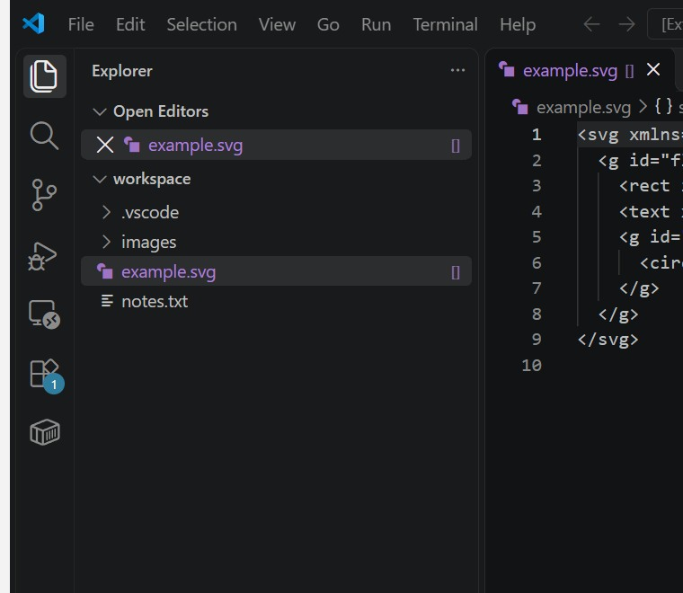
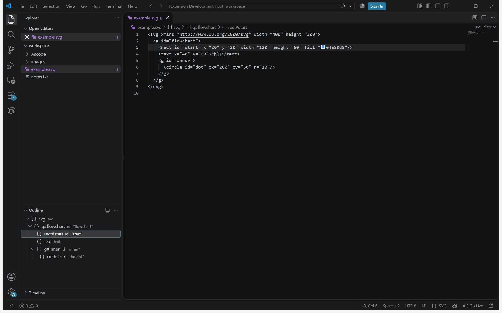

# VSCode 插件实践分析（Lab1 Phase 2）

本文对应实验指导书 A.3 的四个问题：

1. [VSCode 与插件各自的职责，以及功能是如何注册、在什么时机被调用的](#1-vscode-与插件各自的职责与注册调用过程)
2. [文件装饰与 GoF Decorator、Adapter 的对应关系与差异](#2-文件装饰-vs-gof-decorator-与-adapter)
3. [复用 Phase 1 CLI 代码的可能性评估](#3-复用-phase-1-cli-代码的评估)
4. [安装 / 启动 / 调试、示例 SVG 说明与两张截图说明](#4-安装启动调试示例与截图说明)

实现代码：`vscode-extension/src/`（`extension.ts`、`SvgBadgeProvider.ts`、`SvgOutlineParser.ts`）。
使用说明见 [vscode-extension/README.md](../vscode-extension/README.md)。

---

## 1. VSCode 与插件各自的职责与注册调用过程

### 1.1 职责边界：宿主画界面，插件只回答数据

| 关注点 | VSCode（workbench + extension host 基础设施） | 插件（本扩展） |
| --- | --- | --- |
| 进程与生命周期 | 决定何时启动 extension host、何时加载哪个扩展、何时卸载（`Disposable`） | 只实现 `activate` / `deactivate`，不创建进程 |
| UI 绘制 | Explorer 行、Outline 树、面包屑、`Go to Symbol` 列表、图标、主题色 | 不绘制任何像素，只返回数据结构 |
| 装饰的合成 | 收集所有 `FileDecorationProvider` 的结果并按优先级/字段合并后渲染 | 对单个 URI 回答「有没有装饰、长什么样」 |
| 符号的呈现 | 把 `DocumentSymbol[]` 渲染成可折叠树、维护选中态、点击时按 `selectionRange` 跳转 | 把文本解析成符号树，附上 `Range` |
| 语言归属 | 维护「扩展名/首行 → languageId」映射表 | 通过 `package.json` 静态声明参与这张表 |
| 性能与调度 | 决定何时重新请求（防抖、缓存失效、取消 `CancellationToken`） | 保证单次调用便宜、可中断、不抛异常 |
| 安全 | 扩展在独立 extension host 进程中运行，崩溃不拖垮窗口 | 不依赖 Node 侧业务模块，最小依赖 |

一句话：**VSCode 负责「什么时候问、怎么画」，插件负责「答案是什么」**。这是典型的控制反转——插件没有 `main` 循环，也没有窗口句柄，全部入口都是宿主回调。

### 1.2 静态注册：`package.json` 的三个字段

```jsonc
{
  "main": "./out/extension.js",          // 宿主从这里 require 出 activate/export
  "engines": { "vscode": "^1.85.0" },    // 宿主据此判断是否加载
  "activationEvents": [
    "onLanguage:svg",                    // 打开 languageId=svg 的文档
    "workspaceContains:**/*.svg",        // 工作区里存在 .svg
    "onCommand:svgOutline.focusOutline"  // 有人执行本扩展的命令
  ],
  "contributes": {
    "languages": [{ "id": "svg", "extensions": [".svg"], "mimetypes": ["image/svg+xml"] }],
    "commands":  [{ "command": "svgOutline.focusOutline", "title": "聚焦 SVG 大纲 (Focus SVG Outline)" }],
    "keybindings": [{ "command": "svgOutline.focusOutline", "key": "ctrl+alt+o",
                      "when": "editorLangId == svg || resourceExtname == .svg" }]
  }
}
```

三个字段各管一段：

- **`contributes`**：纯声明式的「静态能力清单」。它不执行代码，扩展**未激活**时也生效：
  - `languages` 让 `.svg` 在语言选择器里成为 `svg` 语言（并参与语法/图标/文件关联）；
  - `commands` 让命令出现在命令面板，并带标题与分类；
  - `keybindings` 让 `Ctrl+Alt+O` 直接触发命令；`when` 子句限制只在 SVG 上下文里生效。
- **`activationEvents`**：**惰性加载策略**。VSCode 不会在启动时加载所有扩展，只有事件命中才 `require` 入口并调用 `activate`。本扩展选 `onLanguage:svg` + `workspaceContains:**/*.svg`：
  - 前者保证「一打开 SVG 就有大纲」；
  - 后者保证「工作区里存在 SVG 时，Explorer 的徽标在打开文件之前就已经能显示」（装饰提供者必须已注册，宿主才会去问它）。
  - `onCommand:...` 是补充：即使前两个事件都没命中，命令被调用时也能激活。
- **`main` / `engines.vscode`**：入口路径与兼容版本范围；不满足 `engines` 时宿主拒绝加载。

> 取舍说明：`workspaceContains:**/*.svg` 只在**工作区根**可判定时命中（无文件夹的单文件窗口不会命中），因此单文件场景依赖 `onLanguage:svg`。若只想验证大纲、不要启动成本，可以只留 `onLanguage:svg`，代价是"还没打开 SVG 时 Explorer 里看不到徽标"。

### 1.3 动态注册：`activate()` 里的三个 `registerXxxProvider`

```ts
export function activate(context: vscode.ExtensionContext): void {
  context.subscriptions.push(
    vscode.window.registerFileDecorationProvider(new SvgBadgeProvider()),
  );
  context.subscriptions.push(
    vscode.languages.registerDocumentSymbolProvider(SVG_SELECTOR, new SvgDocumentSymbolProvider(),
      { label: 'SVG Outline' }),
  );
  context.subscriptions.push(
    vscode.commands.registerCommand(FOCUS_OUTLINE_COMMAND, async () => {
      await vscode.commands.executeCommand('outline.focus');
    }),
  );
}
```

要点：

- 每个 `register*` 都**返回 `Disposable`**，统一塞进 `context.subscriptions`；扩展被禁用/卸载/窗口关闭时宿主自动调用 `dispose()`，注册随之撤销。
- `activate` 只会执行一次（每次窗口/宿主会话一次），因此注册必须是**幂等的一次性动作**，不能放在每次请求里。
- 插件传进去的是**对象**，宿主只认它声明的方法（鸭子类型 / 结构化接口）：
  - `SvgBadgeProvider implements FileDecorationProvider` → `provideFileDecoration(uri, token)`；
  - `SvgDocumentSymbolProvider implements DocumentSymbolProvider` → `provideDocumentSymbols(document, token)`。
- 选择器 `SVG_SELECTOR = [{ language: 'svg' }, { language: 'xml', pattern: '**/*.svg' }]` 表达「哪些文档归我管」：
  - 第一项是常规路径（本扩展声明了 `svg` 语言 id）；
  - 第二项兜底：如果 `.svg` 仍被内置 `xml` 扩展接管（或用户手改用 `xml`），照样出大纲，而普通 `.xml` 文件不受影响（`pattern` 限定文件名）。

### 1.4 宿主在什么时机调用这些功能

| 功能 | 宿主调用时机 | 本实现的关键点 |
| --- | --- | --- |
| `provideFileDecoration(uri, token)` | Explorer 渲染某个文件行时按需调用（还会用于 Quick Open、搜索结果、打开编辑器列表等）。宿主按 URI 缓存结果，文件系统变化/装饰自身失效时清缓存。 | 先用 `uri.scheme !== 'file'` 过滤虚拟文档，再用 `path` 后缀粗筛，最后 `workspace.fs.stat` 确认不是目录；返回 `{ badge: '[]', tooltip: 'SVG file', color: ThemeColor('charts.purple') }`，目录/不存在/被取消一律 `undefined`。 |
| `provideDocumentSymbols(document, token)` | 文档打开、切换到该编辑器、文本变更后（宿主内部防抖）重建符号时调用；Outline、面包屑、`Ctrl+Shift+O`、`Ctrl+T` 都复用它。 | 每次全量扫描 `document.getText()`，用 `try/catch` 包住并返回 `[]` 兜底；因此**「编辑后自动更新」不需要我们监听 `onDidChangeTextDocument`**——宿主会重新问一次。 |
| 命令回调 | 用户在命令面板选择命令、按 `Ctrl+Alt+O`、或 `executeCommand` 时。 | 转调内置 `outline.focus`，把 Outline 视图聚焦并展开（本机构建里该视图默认折叠在 Explorer 底部）。 |

由此可以看清「自动更新」的两条链路：

1. 用户敲键盘 → 文档 `version` 变化 → 宿主判定符号缓存失效 → 再次调用 `provideDocumentSymbols` → 新 `DocumentSymbol[]` 替换旧树；
2. 我们**不缓存**任何跨调用的状态（`SvgDocumentSymbolProvider` 是无字段对象，`SvgOutlineParser.parse` 是纯函数），所以不会有"上一次结果污染下一次"的问题，也不会因为文档切换而错位。

另外两个工程细节：

- `CancellationToken`：宿主在用户继续输入时取消上一次请求。我们只在入口做一次 `isCancellationRequested` 快速返回（解析是毫秒级，没必要做细粒度分段取消）。
- 异常边界：回调里**任何**抛出都会被宿主记录到扩展宿主日志并让该功能"消失"。因此 `parse()` 内部自带 `try/catch` 返回 `[]`，外层再包一层 `try/catch`；这是「XML 不完整不得崩溃」这条需求的实现位置。

---

## 2. 文件装饰 vs GoF Decorator 与 Adapter

### 2.1 GoF Decorator 的原始形态

```ts
interface Component { render(): string }
class Text implements Component { render() { return 'file'; } }
class Border implements Component {                    // 装饰器
  constructor(private inner: Component) {}            // 持有同一接口的对象
  render() { return `[${this.inner.render()}]`; }     // super.decorate() 式链式委托
}
new Border(new Border(new Text())).render();           // 组合出 "[[file]]"
```

四个识别特征：**同一接口**、**持有被装饰者**、**调用前后增强并转发**、**可任意层叠**。

### 2.2 VSCode 的 `FileDecorationProvider` 与它的对应关系

本扩展：

```ts
export class SvgBadgeProvider implements vscode.FileDecorationProvider {
  provideFileDecoration(uri, token): vscode.ProviderResult<vscode.FileDecoration> {
    if (uri.scheme !== 'file' || !isSvgPath(uri.path)) return undefined;
    return this.decorateFile(uri, token);           // → { badge, tooltip, color } 或 undefined
  }
}
```

| 维度 | GoF Decorator | VSCode `FileDecorationProvider` |
| --- | --- | --- |
| 与被装饰者的关系 | 包装同一个 `Component` 对象，持有其引用 | **不包装任何东西**；Explorer 行视图是宿主的私有实现，插件拿不到、也包不住 |
| 交互方向 | push：调用 `inner.render()` 时逐层叠加 | **pull：宿主来问**「这个 URI 的装饰是什么？」，插件回答一个值 |
| 多个装饰来源 | 显式嵌套，顺序由构造决定 | 宿主收集**所有**已注册 provider 的结果，按优先级/字段合并后统一绘制；provider 之间互不知晓 |
| 链式委托 | `super.decorate()` / `inner.render()` 是核心机制 | **不存在**；没有 `super`，也没有"转发给下一个装饰器"的入口 |
| 产物 | 有行为的对象，可再被包装 | **值对象（DTO）**：`FileDecoration` 只有 `badge` / `tooltip` / `color` / `propagate` 四个字段，无方法、可缓存、可合并 |
| 可叠加性 | 无限层叠 | 受宿主合并策略与 DTO 字段约束（两个 provider 都设 `badge` 时只能留一个） |

结论：**意图相同（在不修改对象本身的前提下附加界面信息），结构不同**。VSCode 把 GoF 装饰器的"包装 + 链式委托"替换成了"**注册 + 查询 + 宿主合并渲染**"：

- 没有 `super.decorate()`，所以装饰逻辑是**无状态的纯函数**（本扩展的 provider 没有任何字段）；
- 装饰者无法影响渲染过程，只能提交数据，因此**能力被收窄成 DTO 字段**；
- 顺序与冲突解决从"代码里的嵌套层级"变成"宿主的优先级规则"，插件侧不可见——这是可组合性的代价，也是解耦的收益（Git 装饰、错误装饰、本扩展的 `[]` 可以同时存在而互不干扰）。

顺带一个设计后果：因为产物是值对象，宿主可以做**按 URI 缓存**与**失效通知**；而 GoF 装饰器链通常无法缓存（每次调用都跑一遍）。本扩展因此没做自己的缓存——缓存归宿主管，我们只保证 `provideFileDecoration` 便宜。

### 2.3 与 Adapter 的对应关系

**A.1 的 Adapter 视角**：把「文件名/URI → 徽标/颜色/提示」这个**领域需求**，适配成 VSCode 的 `FileDecoration` 契约。

- 目标接口（Adaptee 侧被使用的能力）：`provideFileDecoration(uri, token) → ProviderResult<FileDecoration>`；
- 被适配者：领域规则「哪些文件算 SVG」（`isSvgPath`）、「目录不算」（`workspace.fs.stat` + `FileType.Directory`）；
- Adapter：`SvgBadgeProvider`——把领域判断翻译成 `{ badge: '[]', tooltip: 'SVG file', color: … }`。

**A.2 的 Adapter 视角**：把**容错 XML 树**适配成**大纲模型**，是更典型的对象适配。

```
文本 ──(SvgOutlineParser，纯领域扫描)──► SvgOutlineNode{ tagName, id, label, start, nameStart, nameEnd, end, children }
                                              │
                                    LineIndex.positionAt(offset)   ← 领域无关的偏移→行列换算
                                              │
                                    toDocumentSymbols(...)          ← Adapter
                                              ▼
                        DocumentSymbol{ name, detail, kind, range, selectionRange, children }  ← VSCode 契约
```

- `SvgOutlineNode` 用**字符偏移**表达位置（领域内自洽、不依赖 vscode）；
- `DocumentSymbol` 用 `Position{line, character}` + 两个 `Range`（`range` 覆盖整元素，`selectionRange` 覆盖标签名）表达位置；
- `LineIndex` + `toDocumentSymbols` 就是适配层：换算出 vscode 的坐标系，并把 `label` / `id="…"` 映射到 `name` / `detail`，把结构映射到 `children`（`SymbolKind.Object`），使 Outline 呈现为可折叠树。

与 GoF Adapter 的差异（两处）：

1. **适配的是契约而不是对象**：Adapter 每次调用都**新建** DTO，不"包住"某个长期存在的对象；没有 `getTarget()` 式的持有关系。
2. **两侧都可以被替换**：把 `SvgOutlineParser` 换成另一套扫描器只要保持 `SvgOutlineNode` 形状；把 VSCode 换成别的编辑器只要重写适配层。这正是把解析器写成纯函数（不 import `vscode`）的理由——**Adapter 的两端可以分别单测**：`tests/outline.test.ts` 只测领域侧，完全不需要 mock `vscode` 模块。

补充：为什么不返回 `SymbolInformation[]`？它是扁平结构（每个条目自带 `Location`），做不出嵌套；Outline 需要的层级只能靠 `DocumentSymbol.children` 表达，代价是必须用 vscode 提供的 `DocumentSymbol` **类**（含可变 `children`），而不是纯字面量对象——所以在手写的 `types/vscode.d.ts` 里必须把它声明成 `class` 而非 `interface`，否则运行时会因为 `new vscode.DocumentSymbol(...)` 的类型不匹配而报错。

---

## 3. 复用 Phase 1 CLI 代码的评估

Phase 1 的仓库结构：`src/domain`（`Shape` 继承体系、`Document`、`GroupShape`）、`src/infrastructure/xml`（`XmlParser`、`XmlEntities`、`XmlElement`）、`src/infrastructure/svg`（`SvgCodec`/`SvgReader`/`SvgWriter`）。逐项评估：

### 3.1 可复用（思路或小段代码）

| Phase 1 位置 | 复用方式 | 在本扩展中的落点 |
| --- | --- | --- |
| `XmlEntities.decode` 的实体表与正则 `&(#x[0-9a-fA-F]+|#\d+|[a-zA-Z]+);` | 思路照搬，代码改写为独立小函数（避免把 `src/**` 拖进扩展编译单元） | `SvgOutlineParser.decodeEntities`，用于把 `id="a&amp;b"` 解成 `a&b`，大纲显示 `rect#a&b` |
| `XmlParser.readName` 的字符集 `[A-Za-z0-9_:.-]`、引号值读取、`<!-- -->` / `<![CDATA[ ]]>` / `<? ?>` / `<!DOCTYPE [ ]>` 的跳过策略 | 词法规则沿用 | `SvgOutlineParser` 的 `isNameChar` / 引号扫描 / `scan()` 里的注释、CDATA、PI、声明分支 |
| `Shape.label()` 的 `` `${typeName}#${id}` `` 命名约定 | 规则复用 | `svgOutlineLabel(tagName, id)`：有非空 `id` 显示 `标签名#id`，否则 `标签名` |

这三条都是"**规则与经验**"级别的复用，不产生跨目录依赖——扩展可以独立编译、独立打包。

### 3.2 不可复用（及原因）

1. **`src/domain/**` 的形状模型（`Shape` / `GroupShape` / `RootShape` / `RectShape` …）**
   - 它们是**编辑器语义**的模型：几何属性（`x/y/width/height`）、可移动可缩放、样式表、`accept(visitor)` 双重分派、`attachTo(parent)` 维护父子链。
   - 构造需要**已分配的 id** 与通过校验的几何值（`Numbers` 解析失败即 `EditorError`）。
   - 大纲需要的是「标签名 + id + 源码区间」，连"这是不是 `rect`"都不关心；用 `Shape` 承载会凭空引入几何校验、样式与 id 策略，且**无法表达 position**（Phase 1 的树根本不含源码位置）。
   - 结论：模型不匹配（语义 vs. 结构），不是"改几行就能用"。

2. **`XmlParser`：一次性、严格、失败即抛**
   - 契约是 **fail-fast**：`parse()` 要求整份文档完整且只有一个根元素，任何偏差都 `throw new EditorError`（`unclosed element`、`expected </g> but found </svg>`、`attribute value must be quoted`、`trailing content`）。这是 CLI 的正确选择——保存/回写时绝不能写入坏文件。
   - 大纲的契约正相反，是 **best-effort**：它跑在**用户正在编辑的不完整文本**上（光标停在第 2 行、`</svg>` 还没敲），需要
     (a) 容错：错配结束标签静默隐式闭合、未闭合元素延伸到文末、多余结束标签忽略；
     (b) **保留源码位置**（每个元素的 `start/end` 与标签名区间）——`XmlElement` 完全没有位置信息；
     (c) 绝不抛异常（抛了就等于 Outline 报错消失）。
   - 想复用就要 fork 出第二套错误处理与位置记录，等于重写；而重写的成本很低（约 300 行、零依赖），且换来可独立单测的纯函数。
   - 另外 `XmlParser` **丢弃**注释、CDATA 之外的空白结构、属性顺序与原始引号形式，这些恰好是大纲"节点必须能对上源码"时最需要的原材料。

3. **`Document`（id 索引 + attach/detach + 选择集）**
   - `Document` 内部维护 `shapesById: Map<string, Shape>`、`attach/detach` 时同步父子链与索引、`find(id)`、`size` 等；这些是**可变编辑会话**的状态。
   - 大纲是**只读视图**，每次请求都是对当前文本的一次性投影：引入可变状态反而制造"文档变了但索引没更新"的不一致风险（`DocumentSymbolProvider` 会被高频调用）。
   - 结论：状态是多余的，收益为负。

4. **运行环境与打包边界**
   - VSCode 扩展跑在**独立 extension host 进程**里，入口只有 `out/extension.js`；`src/**` 是 TS 源码，`out/` 只编译 `vscode-extension/src`。
   - 跨目录 `import '../../src/infrastructure/xml/XmlParser'` 会让扩展编译单元依赖仓库根的 `tsconfig`/输出布局，并且 `XmlParser` 又依赖 `domain/errors/EditorError` —— 一拖就是一整片 `domain`。
   - 常规做法是打包（esbuild/webpack 打成单文件），但本实验**要求离线、不依赖 npm 安装**，所以选了"零依赖 + 自带最小 `vscode.d.ts`"的路线：`tsc -p vscode-extension/tsconfig.json` 一条命令搞定，产物可直接被宿主加载。

5. **语言关联的相互影响**（顺带说明取舍）
   - 内置 `xml` 扩展的 `contributes.languages` 已经把 `.svg` 归到 `xml`；本扩展再声明 `svg` 语言 id 会**覆盖**该关联，代价是 `.svg` 不再使用 `text.xml` 语法高亮。
   - 为不破坏"还能出大纲"的路径，符号提供者额外注册了 `{ language: 'xml', pattern: '**/*.svg' }`；若使用者更在意高亮，删除 `contributes.languages` 即可回到 `xml` 语言而大纲仍然工作（这一点在 README 的「已知限制」里也写了）。

---

## 4. 安装、启动、调试、示例与截图说明

### 4.1 编译与启动（离线）

```powershell
# 编译（用仓库内已安装的 TypeScript 5.9.3，不联网）
node ../node_modules/typescript/bin/tsc -p tsconfig.json          # 在 vscode-extension/ 下
node node_modules/typescript/bin/tsc -p vscode-extension/tsconfig.json   # 或在仓库根

# F5：在 VSCode 中打开 vscode-extension 目录 → F5
#     .vscode/tasks.json 先跑 tsc: build，.vscode/launch.json 用下面这条等价命令启动宿主
code --extensionDevelopmentPath="<repo>\vscode-extension" --new-window "<repo>\vscode-extension\examples"

# 装成普通扩展（离线）：把目录拷进扩展目录，重启 VSCode
Copy-Item -Recurse vscode-extension "$env:USERPROFILE\.vscode\extensions\lab1.vscode-svg-outline-0.1.0"
# 或联网时：vsce package → code --install-extension *.vsix
```

调试：在 `src/extension.ts` 或 `src/SvgOutlineParser.ts` 里下断点，F5 启动的宿主里操作 SVG 即可命中；`activate` 的打印在「输出 → 扩展宿主」通道。

### 4.2 示例 SVG

`vscode-extension/examples/example.svg`：

```xml
<svg xmlns="http://www.w3.org/2000/svg" width="400" height="300">
  <g id="flowchart">
    <rect id="start" x="20" y="20" width="120" height="60" fill="#4a90d9"/>
    <text x="40" y="60">开始</text>
    <g id="inner">
      <circle id="dot" cx="200" cy="50" r="10"/>
    </g>
  </g>
</svg>
```

预期大纲：`svg` → `g#flowchart` → {`rect#start`, `text`（无 id）, `g#inner` → `circle#dot`}。
`examples/outline-demo.svg` 额外覆盖注释、CDATA、属性值含 `>`（`data-note="x > y"`）、`defs/linearGradient`、自闭合标签。

### 4.3 两张截图各自证明什么

#### 图 1 `docs/images/vscode-svg-badge.jpg`（760×660）



证明 **A.1**：

- `example.svg` 在 Explorer 树里右侧有 `[]` 徽标（打开编辑器列表里同一文件也有），说明 `window.registerFileDecorationProvider` 生效、`provideFileDecoration` 返回的 `badge` 被宿主渲染；
- 同屏的 `notes.txt`（普通文本文件）、`images` / `.vscode`（目录）**都没有** `[]`，证明后缀判定 + `workspace.fs.stat` 的目录排除都按预期工作；
- 文件名本身没有变化（没有 `example.svg[]` 之类的重命名），体现"标记只是界面附加信息"。

#### 图 2 `docs/images/vscode-svg-outline.jpg`（2183×1365）



证明 **A.2**：

- 左下方原生 **Outline** 面板按嵌套层级展开：`svg` → `g#flowchart` → {`rect#start`, `text`, `g#inner` → `circle#dot`}，有 `id` 的显示 `标签名#id`，右侧 `detail` 列显示 `id="…"`；
- `text` 没有 id，节点就显示为裸标签名 `text`（对应"无 id 元素"要求）；
- 当前选中的是 `rect#start`：编辑器跳到**第 3 行**（状态栏 `Ln 3, Col 6`，行内高亮），面包屑同步为 `example.svg > {} svg > {} g#flowchart > {} rect#start` —— 说明 `selectionRange` 落在标签名上、`range` 覆盖整个元素，点击即定位；
- 窗口标题栏 `[Extension Development Host] workspace` 说明这是**真实运行的扩展开发宿主**，不是设计稿。

补充：两张图都由 `vscode-extension/scripts/capture-screenshots.ps1` 实拍（先 `SetProcessDPIAware()`，再 `PrintWindow(PW_RENDERFULLCONTENT)`，空白时回退 `CopyFromScreen`，最后转 jpg）。早期踩到的坑：PowerShell 是 DPI-unaware 进程时，`GetWindowRect` 返回虚拟化尺寸、`PrintWindow` 只渲染窗口左上 2/3，截图里 Outline 会被整块裁掉——这也解释了我们为什么在脚本里显式声明 DPI 感知。
